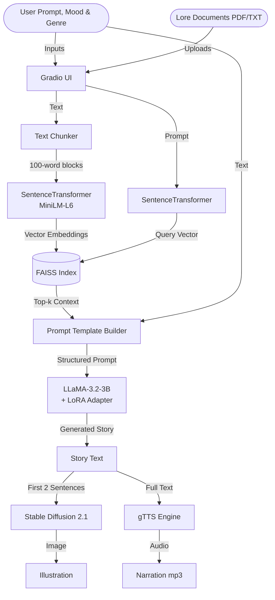

<div align="center">
  <h1>🎭 Mood Story RAG</h1>
  <p>
    <b>An immersive, multimodal storytelling agent powered by LLaMA, LoRA, Stable Diffusion, and RAG.</b>
  </p>
  
  [](https://www.python.org/)
  [](https://pytorch.org/)
  [](https://gradio.app/)
  [](https://opensource.org/licenses/MIT)

</div>

---

## 📖 Overview

**Mood Story RAG** addresses a critical problem in generative AI storytelling: the inability of generalized LLMs to maintain specific, user-defined "world lore" while strictly adhering to episodic, mood-based instructions.

This repository demonstrates a **hybrid architectural approach**:
- **Style via Fine-tuning**: A LoRA adapter on `LLaMA-3.2-3B` forces the model to adhere to literary genres and moods.
- **Knowledge via RAG**: A Retrieval-Augmented Generation pipeline allows users to inject custom PDFs or text files as world rules (lore), preventing hallucinations and ensuring character/world consistency without requiring expensive re-training.

Every generated narrative segment is automatically accompanied by a **Stable Diffusion** visual illustration and optional **gTTS** audio narration, offering a truly multimodal experience.

---

## ✨ Features

- **🧠 Dynamic RAG Injection:** Upload `.txt` or `.pdf` files. The app chunks, embeds (`all-MiniLM-L6-v2`), and indexes them using `FAISS` to pull relevant lore automatically.
- **🎨 Mood & Genre Control:** Enforce strict narrative constraints (e.g., "Dark Fantasy", "Hopeful Sci-Fi").
- **🖼️ Multimodal Output:** Uses `Stable Diffusion 2.1` to generate contextual imagery for every story segment.
- **🎧 Audio Narration:** Instant Text-to-Speech generation via `gTTS`.
- **💾 Export Capabilities:** Download your entire episodic adventure (text + images) as a packaged `.zip` file.

---

## 🏗️ Architecture



---

## 🛠️ Tech Stack

- **LLM Base**: `meta-llama/Llama-3.2-3B-Instruct`
- **Fine-Tuning**: `PEFT / LoRA`
- **Embeddings**: `sentence-transformers/all-MiniLM-L6-v2`
- **Vector DB**: `faiss-cpu`
- **Image Generation**: `diffusers` (Stable Diffusion 2.1)
- **UI Framework**: `gradio`

---

## 🚀 Setup & Installation

### 1. Clone the Repository
```bash
git clone https://github.com/yourusername/mood-story-rag.git
cd mood-story-rag
```

### 2. Install Dependencies
Ensure you have PyTorch installed for your specific CUDA version, then install the requirements:
```bash
pip install -r requirements.txt
```

### 3. Environment Variables
Copy the example environment file and add your Hugging Face token (required to download LLaMA and SD weights):
```bash
cp .env.example .env
```

### 4. Run the Application
The application is structured modularly inside the `app/` directory. Launch it using:
```bash
python -m app.main
```

Then, open your browser to `http://localhost:7860/`.

---

## 📁 Repository Structure

```
mood-story-rag/
├── app/
│   ├── main.py          # Entry point & Gradio UI
│   ├── rag_pipeline.py  # FAISS Vector indexing & retrieval
│   ├── multimodal.py    # Stable Diffusion & TTS logic
│   └── utils.py         # PDF parsing & chunking helpers
├── data/
│   └── sample_lore/     # Example lore files for testing
├── notebooks/
│   └── exploration.ipynb  # Original Kaggle experiments
├── requirements.txt
└── README.md
```

<p align="center">
  <i>Built as an exploration into combining Parameter-Efficient Fine-Tuning with RAG architectures.</i>
</p>
