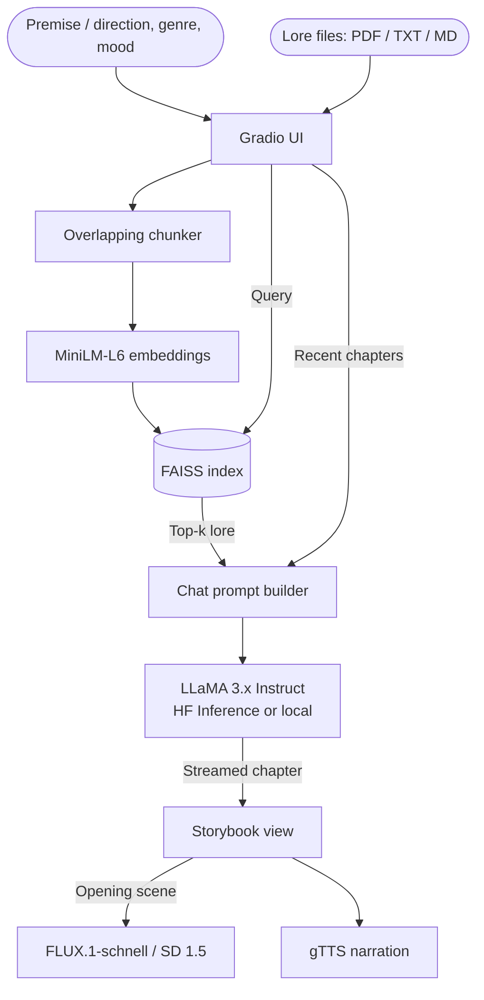

<div align="center">
  <h1>🎭 Mood Story RAG</h1>
  <p><b>An illustrated, episodic storyteller that keeps your world's lore straight.</b></p>

  [](https://www.python.org/)
  [](https://gradio.app/)
  [](https://opensource.org/licenses/MIT)
</div>

---

## 📖 Overview

General-purpose LLMs are good storytellers, but they drift: names change, rules of the world get broken, and the tone wanders away from what you asked for. **Mood Story RAG** tackles this with two levers:

- **Knowledge via RAG:** upload your world's lore (PDF, TXT or Markdown). It is chunked, embedded and indexed with FAISS, and the most relevant passages are injected into every chapter as canon.
- **Style via mood-conditioned prompting:** genre and mood shape word choice, pacing and imagery through a structured system prompt.

Each chapter streams in live, gets its own AI illustration, and can be narrated aloud. Continue the story chapter by chapter, steering what happens next, then export the whole thing.

## ✨ Features

- **Episodic stories:** begin from a premise, then continue chapter by chapter, steering with your own direction or one of three suggested "what happens next" choices.
- **Consistent characters:** a running cast list gives each character a fixed visual description that's reused in every illustration and fed back to the writer.
- **Story so far:** a running summary at the end of the story, which also stands in for older chapters so long stories stay coherent.
- **Art styles:** storybook painting, hand-drawn anime, watercolor, comic book, 3D animated, cinematic photo, oil, pixel art, or ink & charcoal.
- **Lore-grounded generation (RAG):** multiple lore files, overlapping chunks, cosine-similarity retrieval with `all-MiniLM-L6-v2` + FAISS.
- **Live streaming:** text appears as it's written.
- **Illustrations:** each chapter's key moment is illustrated by FLUX.1-schnell (or Stable Diffusion locally).
- **Narration:** text-to-speech for the latest chapter via gTTS.
- **Export:** download the story as Markdown plus images in a `.zip`.
- **Two backends:** hosted models via Hugging Face Inference Providers (no GPU needed), or fully local models.

## 🏗️ Architecture



## 🚀 Run locally

```bash
git clone https://github.com/yourusername/mood-story-rag.git
cd mood-story-rag
python -m venv .venv && source .venv/bin/activate
pip install -r requirements.txt
cp .env.example .env   # then add your HF token
python run.py
```

Open http://localhost:7860.

**Hugging Face token:** create a fine-grained token at [huggingface.co/settings/tokens](https://huggingface.co/settings/tokens) with **"Make calls to Inference Providers"** enabled, and put it in `.env` as `HF_TOKEN`.

### Dependencies

`requirements*.txt` are lock files with every package pinned, so local runs and the Space install exactly the same versions. Edit the matching `requirements*.in` file instead, then regenerate the lock with the command at the top of the `.txt` file (needs `pip install -r requirements-dev.txt`). To upgrade a single package, add `--upgrade-package <name>` to that command.

### Running models on your own machine

To run LLaMA-3.2-3B and Stable Diffusion 1.5 locally instead (a GPU or Apple Silicon is strongly recommended):

```bash
pip install -r requirements-local.txt
MODEL_BACKEND=local python run.py
```

The LLaMA weights are gated: accept the license on the [model page](https://huggingface.co/meta-llama/Llama-3.2-3B-Instruct) first. Models can be overridden with `TEXT_MODEL` and `IMAGE_MODEL`.

## ☁️ Deploy to Hugging Face Spaces

This repo is ready to run as a Gradio Space on free CPU hardware (the YAML header above is the Space config).

1. Create a new Space at [huggingface.co/new-space](https://huggingface.co/new-space) with the **Gradio** SDK and **CPU basic** hardware.
2. Push this repo to the Space:
   ```bash
   git remote add space https://huggingface.co/spaces/<your-username>/mood-story
   git push space main
   ```

**Who pays for inference.** By default, visitors to the Space must sign in with Hugging Face, and their chapters run on *their own* free inference credits (the `hf_oauth` settings above). Your account isn't charged for other people's stories.

To let people use it without signing in, add these in the Space's **Settings → Variables and secrets**:

| Name | Type | Value |
|---|---|---|
| `HF_TOKEN` | Secret | your token (with Inference Providers permission); this account pays for everyone |
| `REQUIRE_LOGIN` | Variable | `false` |
| `CHAPTERS_PER_DAY` | Variable | per-visitor daily cap, default `10` (`0` = unlimited) |

### Other settings

| Variable | Default | Purpose |
|---|---|---|
| `TEXT_MODEL` / `IMAGE_MODEL` | Llama-3.1-8B-Instruct / FLUX.1-schnell | Main models |
| `TEXT_FALLBACK_MODELS` / `IMAGE_FALLBACK_MODELS` | Llama-3.3-70B-Instruct / SDXL base | Comma-separated backups used if the main model is unavailable |
| `FILE_RETENTION_HOURS` | `24` | Generated images, audio and exports older than this are deleted |

## ⚖️ Licenses & content

- Code: MIT.
- Text generation is **Built with Llama**: Llama 3.1 and 3.3 are under the [Llama Community License](https://www.llama.com/llama3_1/license/), which requires that attribution.
- FLUX.1-schnell is Apache 2.0, and SDXL uses the CreativeML Open RAIL++-M license.
- Stories are kept general-audience: the models are instructed to avoid explicit content and graphic gore, and clearly unacceptable prompts are refused. This isn't a full moderation system, so treat outputs as unreviewed AI content.

## 📁 Repository structure

```
mood-story-rag/
├── run.py                 # Entry point (local + Spaces)
├── app/
│   ├── main.py            # Gradio UI and event handlers
│   ├── style.css          # Storybook styling
│   ├── config.py          # Env vars, backend + model selection
│   ├── llm.py             # Prompt building and streaming generation
│   ├── rag_pipeline.py    # Embeddings, FAISS index, retrieval
│   ├── safety.py          # Prompt blocklist
│   ├── multimodal.py      # Illustrations and narration
│   └── utils.py           # Lore file parsing and chunking
├── notebooks/
│   └── exploration.ipynb  # Original Kaggle experiments (incl. LoRA fine-tuning)
├── requirements.txt       # Hosted-API deployment
└── requirements-local.txt # Extra deps for local models
```

<p align="center"><i>Started as a college project exploring LoRA fine-tuning and RAG for controllable storytelling.</i></p>
