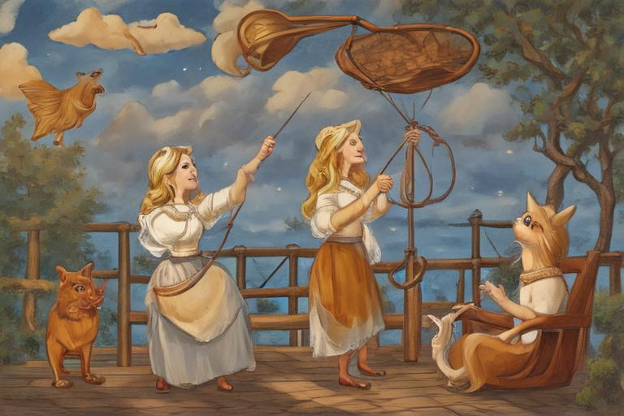
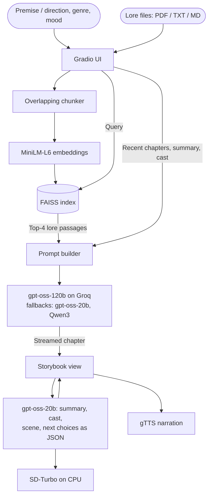

<div align="center">
  <h1>🎭 Mood Story RAG</h1>
  <p><b>An illustrated, episodic storyteller that keeps your world's lore straight.</b></p>

  <p><a href="https://rohanbabbar913--mood-story-web.us-east.modal.run"><b>▶ Try it live</b></a> (no sign-in needed)</p>
  <p>First load may take ~20 s while the app wakes up.</p>

  [](https://github.com/RohanBabbar/mood-story-rag/actions/workflows/ci.yml)
  [](https://www.python.org/)
  [](https://gradio.app/)
  [](https://opensource.org/licenses/MIT)
</div>

---

<p align="center"></p>

## 📖 Overview

General-purpose LLMs are good storytellers, but they drift: names change, the rules of the world get broken, and the tone wanders. **Mood Story RAG** keeps a story on track with:

- **Retrieval (RAG):** upload your world's lore (PDF, TXT or Markdown). It is chunked, embedded and indexed with FAISS, and the most relevant passages are fed to every chapter as canon.
- **Story memory:** a running summary and a cast list with fixed character descriptions, reused by both the writer and the illustrator.
- **A structured prompt:** genre, mood and explicit rules ("something must happen", "never reuse phrases from earlier chapters"), measured against the old prompt below.

Each chapter streams in within a few seconds, gets its own illustration, can be narrated aloud, and ends with three suggested directions for the next one.

**New here?** In the app, press **Read an example** for a finished three-chapter story, or **Try a sample world** to write in a ready-made world with its lore loaded.

## ✨ Features

- **Episodic stories:** start from a premise, then continue chapter by chapter with your own direction or one of three suggested choices.
- **Lore-grounded generation:** multiple lore files, overlapping chunks, cosine-similarity retrieval with `all-MiniLM-L6-v2` + FAISS. Chapters that used lore are marked.
- **Consistent characters:** each character gets a fixed look (kind, age, hair, clothing, a distinctive feature) that is substituted for their name in every image prompt.
- **Nine art styles,** or no illustrations at all.
- **Live streaming, narration (gTTS) and export** to Markdown + images in a `.zip`.
- **Built for a public demo:** model fallbacks, per-visitor daily limits, input size limits enforced on the server, automatic cleanup of generated files.

## 🏗️ Architecture



## 📊 Evaluation

Scripts and full results are in [`eval/`](eval/).

**Retrieval** ([`eval/rag_eval.py`](eval/rag_eval.py)): 30 paraphrased questions over two lore files written with deliberately look-alike details (two queens, two guardians, two bakeries), so retrieval has to tell similar passages apart. The app's setting retrieves the answering passage in the top 4 for **83%** of questions while sending only 22% of the lore to the model. Overlapping chunks helped at every chunk size; `bge-small` was not consistently better than MiniLM at this sample size, so the smaller model stayed.

**Prompt redesign** ([`eval/story_eval.py`](eval/story_eval.py)): old vs new prompt, 12 premises × 2 chapters each, same seeds, Llama-3.2-3B. Scored with simple text statistics and a zero-shot classifier (`bart-large-mnli`), so these are proxies for comparing versions, not absolute quality.

| Metric | Old prompt | New prompt |
|---|---|---|
| Chapter 2 phrases copied from chapter 1 | 1.3% | **0.1%** |
| Chapters with dialogue | 88% | **100%** |
| Requested genre in classifier's top 3 | 50% | **67%** |
| Requested mood in classifier's top 3 | 46% | 42% (within noise) |

**The LoRA adapter.** The original college project fine-tuned Llama-3.2-3B with LoRA. Testing it with fixed seeds showed its output was *identical* to the base model's: its weight update is about 0.007% of the base weights, so it was effectively untrained. Rather than claim a fine-tune that does nothing, the app uses a stronger hosted model; adapter support stays available for the local backend (`ADAPTER_REPO`), with a toggle to compare base and fine-tuned output side by side.

## 🧭 Design decisions

- **Text on Groq's free tier.** gpt-oss-120b writes a chapter in 2–4 seconds at no cost to visitors, so the demo needs no sign-in. The JSON analysis runs on the smaller gpt-oss-20b, which also keeps it off the story model's rate limit; Groq's limits are per model, so a rate-limited model falls back to the next one.
- **Images on the Space's own CPU.** There is no free hosted image API, so SD-Turbo draws each picture in a single step (under a minute on the free CPU), one at a time. The text is shown first and the picture fills in after. Stable Diffusion reads only 77 prompt tokens, so prompts lead with the core art style, then the scene with each character's look.
- **Never switch models mid-chapter.** Fallbacks happen only before any text has streamed, so a chapter never has a seam where the voice changes.
- **Safety in layers.** Unacceptable premises are refused, the writer is told to keep things general-audience, and illustration prompts are written by the model from the chapter, so a visitor's text never goes straight to the image model.

## 🚀 Run locally

```bash
git clone https://github.com/RohanBabbar/mood-story-rag.git
cd mood-story-rag
python -m venv .venv && source .venv/bin/activate
pip install -r requirements.txt
cp .env.example .env   # then add your Groq API key
python run.py
```

Open http://localhost:7860. A free Groq key is at [console.groq.com/keys](https://console.groq.com/keys). The first illustration downloads SD-Turbo (~5 GB).

### Tests

```bash
pip install -r requirements-dev.txt
ruff check . && pytest
```

The tests replace every model with a small fake, so they run in a couple of seconds with no network or API keys. CI runs them on every pull request.

### Dependencies

`requirements*.txt` are lock files with every package pinned, so local runs and the Space install exactly the same versions. Edit the matching `requirements*.in` file instead, then regenerate the lock with the command at the top of the `.txt` file (needs `pip install -r requirements-dev.txt`). To upgrade a single package, add `--upgrade-package <name>` to that command.

### Running every model on your own machine

To run Llama-3.2-3B and Stable Diffusion 1.5 locally (a GPU or Apple Silicon is strongly recommended):

```bash
pip install -r requirements-local.txt
MODEL_BACKEND=local python run.py
```

## ☁️ Deploy

The live demo runs on [Modal](https://modal.com): a 4-core CPU container that starts when someone opens the page and shuts down after 5 idle minutes, which fits in the free Starter plan's $30 of monthly credits. The first visit after a pause takes about a minute to wake up. Text comes from Groq and appears in about 2 seconds; the CPU draws each picture with SD-Turbo in about 30 seconds while the chapter is already on screen.

```bash
pip install -r requirements-dev.txt
modal setup                                   # log in once
f=$(mktemp) && grep '^GROQ_API_KEY=' .env > "$f" && modal secret create mood-story --from-dotenv "$f"; rm -f "$f"
modal deploy deploy/modal_app.py              # prints the public URL
```

[`deploy/modal_app.py`](deploy/modal_app.py) installs the same locked dependencies and bakes the models into the image so cold starts don't download them.

**Hugging Face Spaces** also works with the YAML header at the top of this file (add `GROQ_API_KEY` as a secret), but hosting a Gradio Space now requires an HF PRO subscription.

### Settings

| Variable | Default | Purpose |
|---|---|---|
| `GROQ_API_KEY` | none | Groq key; when set, text runs on Groq and no sign-in is needed |
| `TEXT_PROVIDER` / `IMAGE_PROVIDER` | `groq` / `sd-turbo` | Use `hf` for Hugging Face Inference Providers (needs `HF_TOKEN` and credits) |
| `TEXT_MODEL` / `ANALYSIS_MODEL` | gpt-oss-120b / gpt-oss-20b | Story writer and JSON analysis models |
| `TEXT_FALLBACK_MODELS` | gpt-oss-20b, Qwen3 | Comma-separated backups tried in order |
| `CHAPTERS_PER_DAY` | `10` on Spaces and Modal | Per-visitor daily cap (`0` = unlimited) |
| `REQUIRE_LOGIN` | on only with `TEXT_PROVIDER=hf` | Visitors sign in so inference uses their own HF credits |
| `FILE_RETENTION_HOURS` | `24` | Generated images, audio and exports older than this are deleted |

## ⚖️ Licenses & content

- Code: MIT.
- gpt-oss and Qwen3 are Apache 2.0. SD-Turbo is under the [Stability AI Community License](https://stability.ai/license). With `TEXT_PROVIDER=hf` or the local backend, text is **Built with Llama** under the Llama Community License.
- Stories and pictures are AI-generated and unreviewed: the safety layers above reduce problems but are not a full moderation system.

## 📁 Repository structure

```
mood-story-rag/
├── run.py                 # Entry point (local + Spaces)
├── app/
│   ├── main.py            # Gradio UI and event handlers
│   ├── style.css          # Storybook styling
│   ├── config.py          # Env vars, provider + model selection
│   ├── llm.py             # Prompts, streaming generation, fallbacks, chapter analysis
│   ├── rag_pipeline.py    # Embeddings, FAISS index, retrieval
│   ├── multimodal.py      # Illustrations and narration
│   ├── safety.py          # Prompt blocklist
│   └── utils.py           # Lore file parsing and chunking
├── data/
│   ├── sample_lore/       # The sample world, also used by the retrieval evaluation
│   └── showcase/          # The "Read an example" story
├── deploy/modal_app.py    # Modal hosting
├── eval/                  # Retrieval and story-quality evaluations, with results
├── scripts/               # make_showcase.py
├── tests/                 # Offline test suite (fake models)
└── notebooks/             # Original Kaggle experiments
```

<p align="center"><i>Started as a college project exploring LoRA fine-tuning and RAG for controllable storytelling.</i></p>
